.. _ngmobile_editing:

Edit layers
=====================

NextGIS Mobile allows you to edit vector layers added to the map.   

* `add a new feature <https://docs.nextgis.com/docs_ngmobile/source/editing.html#ngmobile-add-geometry>`_ to the layer;
* `delete feature <https://docs.nextgis.com/docs_ngmobile/source/editing.html#ngmobile-editing-toolbar-pic>`_;
* change feature:

  * `adjust geometry <https://docs.nextgis.com/docs_ngmobile/source/editing.html#ngmobile-edit-geometry>`_;
  * `change attribute values <https://docs.nextgis.com/docs_ngmobile/source/editing.html#ngmobile-edit-attributes>`_.

If a layer in Web GIS has custom `forms <https://docs.nextgis.com/docs_ngweb/source/form_elements.html>`_ for entering and editing attributes, they are automatically loaded when the layer is added to NextGIS Mobile.

.. _ngmobile_switch_to_edit:

Enter Edit mode
------------------------------

There are several ways to switch to Edit mode: 

1. **Long press** a feature on the screen to activate the Edit mode for the layer. 

If there are multiple features at the selected location, for example, a polygon and a point, a list will appear. Select the layer you want to edit.

A short tap will also bring up the toolbar, but only to view the feature information.

2. In the Layers Tree, open the |ic_menu_grey| **vector layer menu** and select |ic_edit_grey| "Edit".

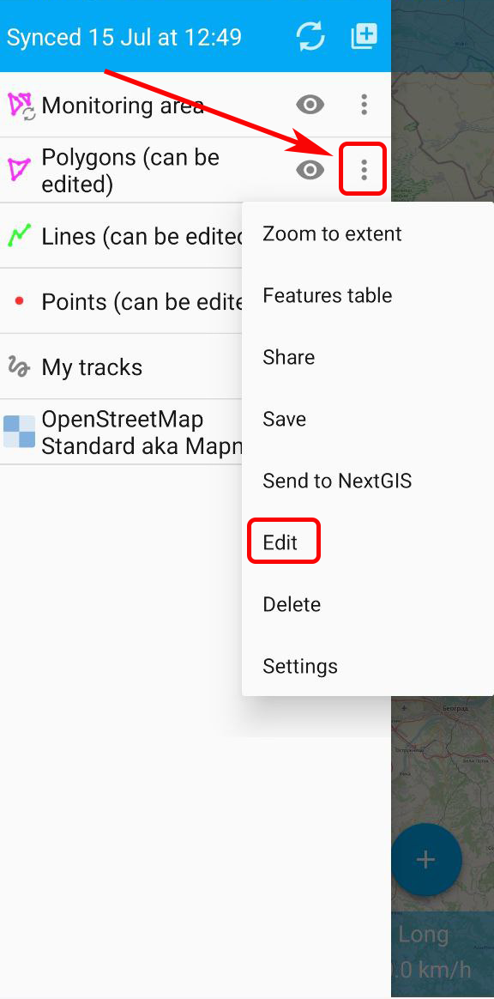
   
   Layer menu

3. Tap the **large blue button** in the bottom right corner to open the main operations menu.

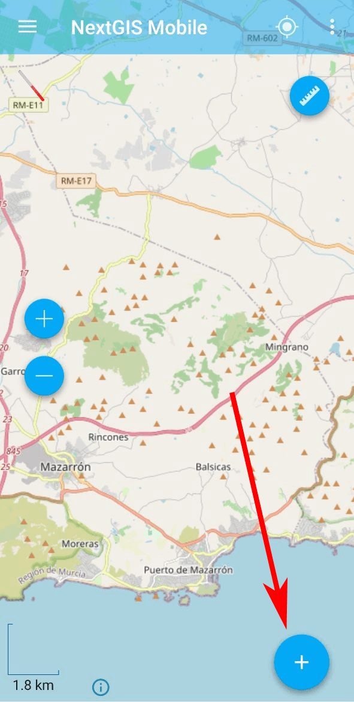

   Main operations menu

Tap |ic_edit| to enter Edit mode.

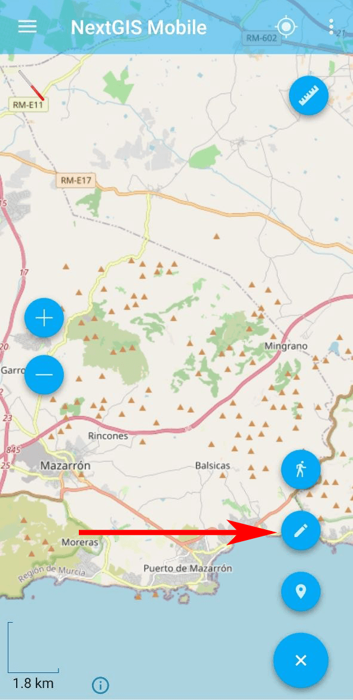

   Starting editing from the main operations menu

In the dialog box that opens, select the desired vector layer. 

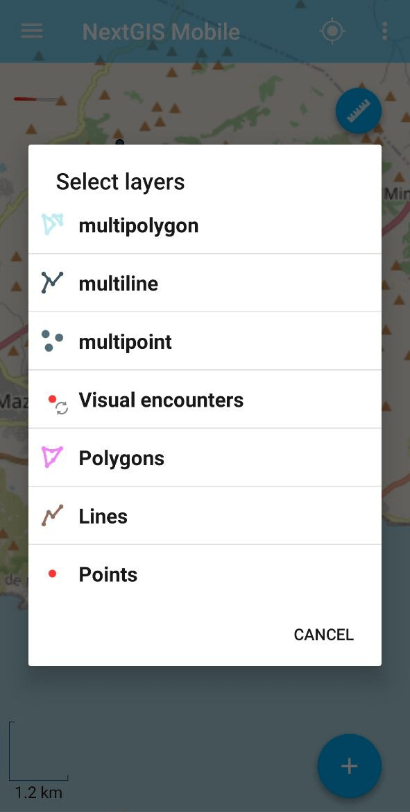
   
   Layer selection dialog

.. _ngmobile_editing_toolbar:

Editing toolbar
----------------------------------

In the `Edit mode <https://docs.nextgis.com/docs_ngmobile/source/editing.html#ngmobile-switch-to-edit>`_, there is a toolbar at the bottom of the screen; it is the same for vector layers with any geometry.

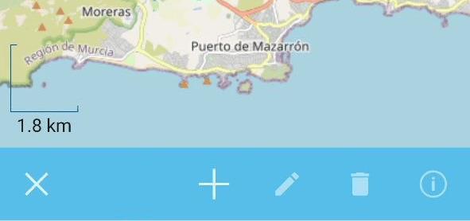
   
   Editing toolbar

With these tools, you can:

* |ic_cancel| Leave Edit mode; 
* |ic_add_feature| `add a new feature <https://docs.nextgis.com/docs_ngmobile/source/editing.html#ngmobile-add-geometry>`_ to the layer; 
* |ic_edit| `adjust geometry <https://docs.nextgis.com/docs_ngmobile/source/editing.html#ngmobile-edit-geometry>`_; 
* |ic_delete| delete feature; 
* |ic_info| view feature attributes and `modify them <https://docs.nextgis.com/docs_ngmobile/source/editing.html#ngmobile-edit-attributes>`_.

When you choose geometry editing, the panel provides tools for the corresponding geometry type:

* `Points/Multipoints <https://docs.nextgis.com/docs_ngmobile/source/editing.html#ngmobile-edit-point>`_;
* `Lines/Multilines <https://docs.nextgis.com/docs_ngmobile/source/editing.html#ngmobile-edit-line>`_;
* `Polygons/Multipolygons <https://docs.nextgis.com/docs_ngmobile/source/editing.html#ngmobile-edit-polygon>`_.

.. _ngmobile_add_geometry:

Add feature
-------------------

Activate Edit mode <https://docs.nextgis.com/docs_ngmobile/source/editing.html#ngmobile-switch-to-edit>_ from the layer menu or via the large blue button in the bottom right corner, see. :ref:`ngmobile_switch_to_edit`. 

In the editing toolbar, click |ic_add_feature|.

For each geometry type, there are some particularities, described in more details below:

* `Point <https://docs.nextgis.com/docs_ngmobile/source/editing.html#ngmobile-add-point>`_
* `Line <https://docs.nextgis.com/docs_ngmobile/source/editing.html#ngmobile-add-line>`_
* `Polygon <https://docs.nextgis.com/docs_ngmobile/source/editing.html#ngmobile-add-polygon>`_

After entering the geometry, tap |ic_save|. The attribute input screen opens.

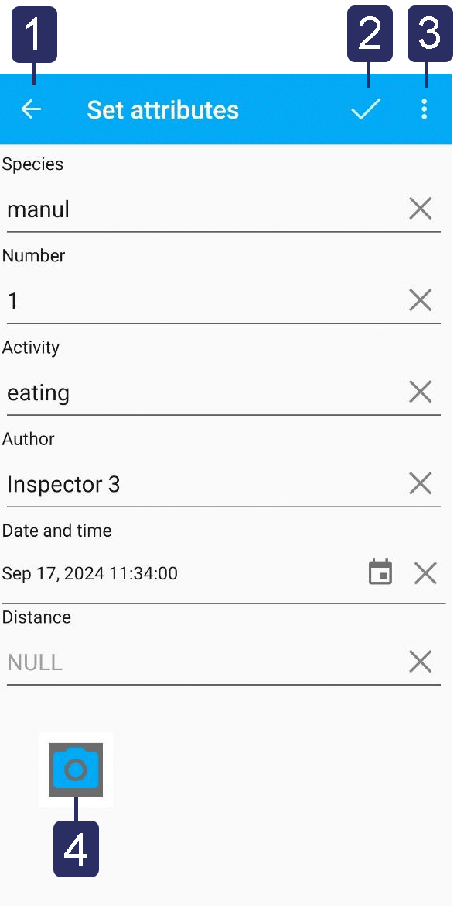
   
   Entering attributes.
   
   The numbers indicate: 1 - back; 2 - apply changes; 3 - add photo.
   
You can attach photos to a feature using the "Add photo" button |ic_photo|.

Fill in the required fields, click |ic_tick| to complete feature creation.

Below is a more detailed description of creating different types of geometries.

.. _ngmobile_add_point:

Create point
^^^^^^^^^^^^^^

Select a vector layer with point/multipoint geometry type. `Switch to Edit mode <https://docs.nextgis.com/docs_ngmobile/source/editing.html#ngmobile-switch-to-edit>`_ from the layer's menu or via the large blue button in the bottom right corner.

On the editing toolbar, tap |ic_add_feature| "Add new feature".

A new point will appear in the center of the screen, highlighted in red. A cursor |ic_action_anchor| will be displayed next to the point. 

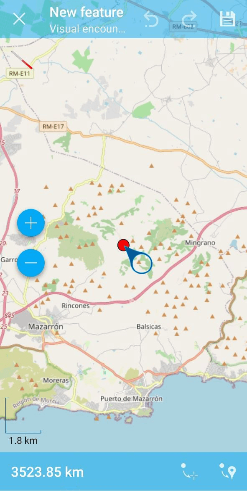

   Adding a point to a point layer

To move the point, hold the arrow |ic_action_anchor| and drag it to the desired location. 

The following buttons are available in the top panel:

* |ic_cancel| exit Edit mode (without saving); 
* |ic_undo| undo changes; 
* |ic_redo| redo changes; 
* |ic_save| save geometry changes and proceed to entering feature attributes; 

In the bottom panel: 

* |ic_move_to_center| move the point to the center of the screen; 
* |ic_move_to_loc| move the point to the current location.

To add a feature consisting of multiple points to a layer with **multipoint geometry** after adding the first point click "Add Point" |ic_add_point|. The new point can also be moved using the arrow |ic_action_anchor|.
    
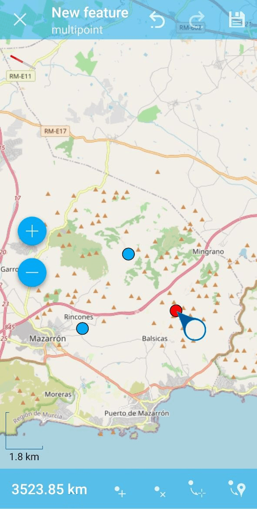

   Adding a point to a multipoint layer
   
Additional tools for multipoint features:

* |ic_add_point| add point to multipoint feature;
* |ic_delete_point| delete point from multipoint feature.
    
After the point is set to the desired location, tap |ic_save|. The created geometry is saved and the `attribute form <https://docs.nextgis.com/docs_ngmobile/source/editing.html#ngmobile-input-form-attributes-pic>`_ is open. 

After all attributes are set, tap "Apply Changes" |ic_tick| to save the attributes.

See how to add and label points in our videos:

.. raw:: html

   <iframe width="560" height="315" src="https://www.youtube.com/embed/WzMJE9ExGXA?si=9hS3ZjkTWM4pgYDi" title="YouTube video player" frameborder="0" allow="accelerometer; autoplay; clipboard-write; encrypted-media; gyroscope; picture-in-picture; web-share" referrerpolicy="strict-origin-when-cross-origin" allowfullscreen></iframe>

Watch on `youtube <https://youtu.be/WzMJE9ExGXA?si=8yor6iJIVjswuuTu>`_.

.. raw:: html

   <iframe width="560" height="315" src="https://www.youtube.com/embed/5M9uzmU_lgA?si=WVE0W30cnQ_C2m-L" title="YouTube video player" frameborder="0" allow="accelerometer; autoplay; clipboard-write; encrypted-media; gyroscope; picture-in-picture; web-share" referrerpolicy="strict-origin-when-cross-origin" allowfullscreen></iframe>

Watch on `youtube <https://youtu.be/5M9uzmU_lgA?si=ow5589SuuR70Dg1S>`__.

.. _ngmobile_add_line:

Create line
^^^^^^^^^^^^^^

Select a vector layer with linestring geometry. `Switch to Edit mode <https://docs.nextgis.com/docs_ngmobile/source/editing.html#ngmobile-switch-to-edit>`_ from the layer's menu or via the large blue button in the bottom right corner.

On the editing toolbar, tap |ic_add_feature| "Add new feature".

A new line will appear in the center of the screen. One of the line's vertices will be highlighted and have a cursor |ic_action_anchor| next to it. Use the cursor to drag the vertices anywhere on the map. 

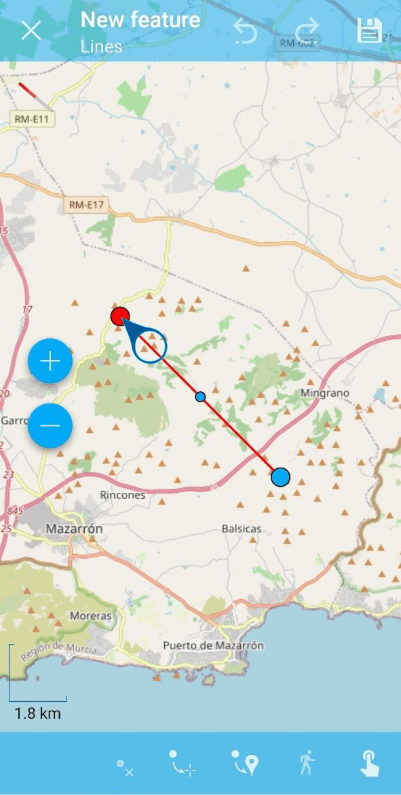

   Adding a line

The following buttons are available in the top panel:

* |ic_cancel| exit Edit mode (without saving); 
* |ic_undo| undo changes; 
* |ic_redo| redo changes; 
* |ic_save| save geometry changes and proceed to entering feature attributes; 

In the bottom panel: 

* |ic_delete_point| delete vertex;
* |ic_move_to_center| move vertex to the center of the screen; 
* |ic_move_to_loc| move vertex to the current location;
* |ic_walk| add vertices by walking;
* |ic_touch| add vertices by touch.

To **add a new vertex**, click on the point in the middle of the segment and drag it to the side.

Add any number of vertices to create a complex line.

To add a feature consisting of multiple lines to a layer with **multiline** geometry after adding the first line tap "Add Line" |ic_add_line|. After this, you can set the positions of the vertices of the new line.

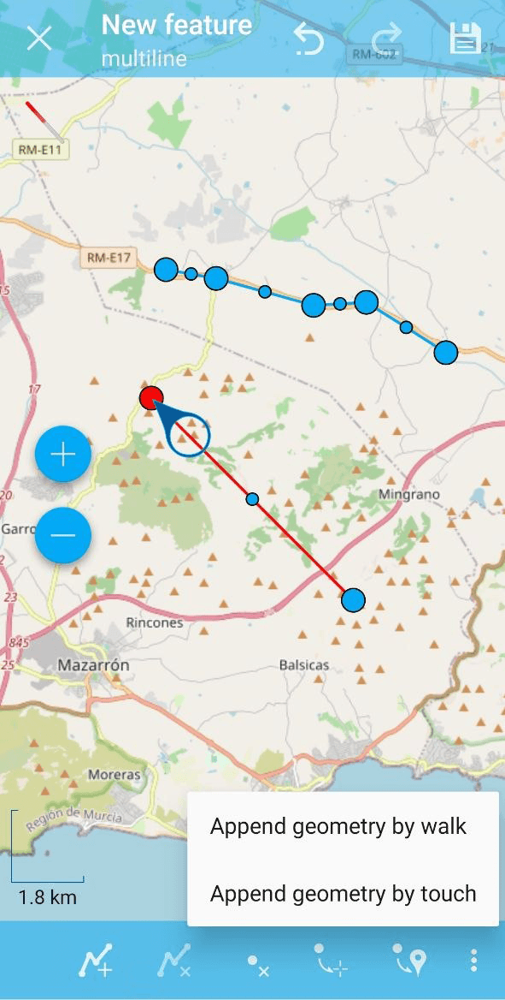

   Adding a line to a multiline layer
   
The following additional buttons are available for multilines:

* |ic_add_line| add line;
* |ic_delete_line| delete line.

Adding geometry by walking and touch may not fit on the screen; in that case, tap the three dots to see hidden options.

After adding a new line, tap |ic_save|. The created geometry is saved and the `attribute form <https://docs.nextgis.com/docs_ngmobile/source/editing.html#ngmobile-input-form-attributes-pic>`_ is open.

Fill in the form fields and tap "Apply changes" |ic_tick| to save the attributes.

.. _ngmobile_add_polygon:

Create polygon
^^^^^^^^^^^^^^^^^

Select a vector layer with polygon/multipolygon geometry type. `Switch to Edit mode <https://docs.nextgis.com/docs_ngmobile/source/editing.html#ngmobile-switch-to-edit>`_ from the layer's menu or via the large blue button in the bottom right corner.

On the editing toolbar, tap |ic_add_feature| "Add new feature".

A new polygon, a triangle, will appear in the center of the screen. One of the polygon's vertices will be highlighted, with a cursor |ic_action_anchor| next to it. To **move a vertex** of a polygon, select it, then drag the cursor to the desired location. 

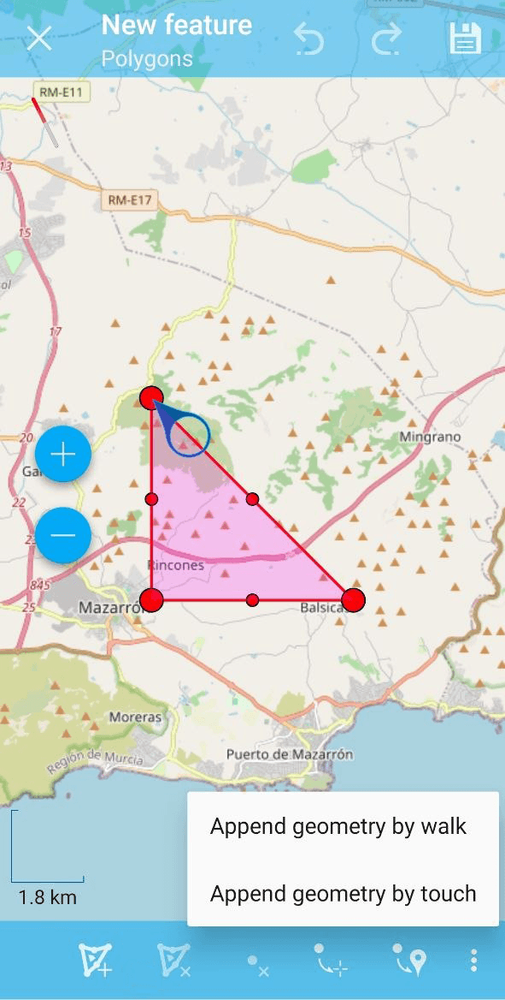

   Adding a polygon

The following buttons are available in the top panel:

* |ic_cancel| exit Edit mode (without saving); 
* |ic_undo| undo changes; 
* |ic_redo| redo changes; 
* |ic_save| save geometry changes and proceed to entering feature attributes; 

In the bottom panel: 

* |ic_hole| add inner ring;
* |ic_delete_hole| delete inner ring;
* |ic_delete_point| delete vertex;
* |ic_move_to_center| move vertex to the center of the screen; 
* |ic_move_to_loc| move vertex to the current location;

Tap on the three dots to open a menu with other functions that didn't fit on the panel:

* |ic_walk| add vertices by walking;
* |ic_touch| add vertices by touch.

To **add a vertex**, tap on the point in the middle of the polygon's side and drag it.
You can add any number of vertices and modify the polygon geometry.

To cut a **hole** in a polygon, tap the "Add inner ring" button |ic_hole|. The ring geometry can be adjusted the same as the polygon.

.. note::
   The ring geometry must be located INSIDE the polygon geometry, otherwise the changes will not be saved!

To add a feature consisting of multiple polygons to a **multipolygon** layer, create the first polygon, then tap "Add Polygon" |ic_add_polygon|. Next, set the geometry of the new polygon.

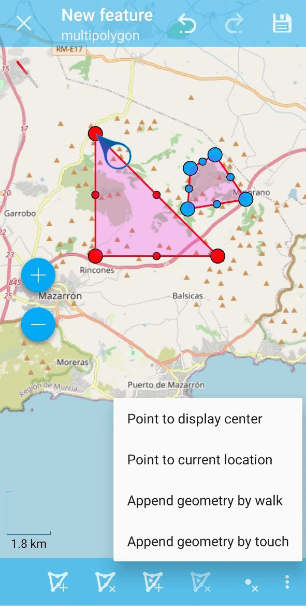

   Adding a polygon to a multipolygon layer

Additional buttons are available for multipolygons:

* |ic_add_polygon| add polygon;
* |ic_delete_polygon| delete polygon.

After adding a new polygon, tap |ic_save|. The created geometry is saved and the `attribute form <https://docs.nextgis.com/docs_ngmobile/source/editing.html#ngmobile-input-form-attributes-pic>`_ is open.

Fill in the form fields and tap "Apply changes" |ic_tick| to save the attributes.

.. _ngmobile_add_location:

Mark current location
----------------------------------

The current location can be added to a vector layer **with point or multipoint geometry**.

Click the large blue button in the bottom corner and select the icon with the pushpin image |ic_place|. 

In the dialog that opens, select the desired vector layer. If only one point/multipoint layer is available, it will be selected automatically.

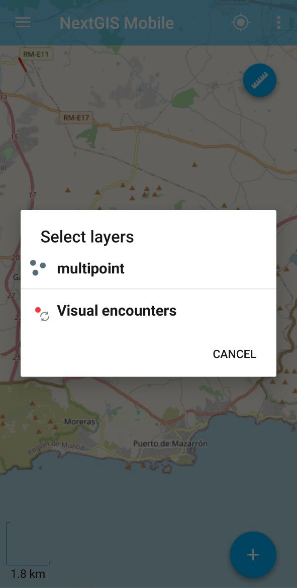
   
   Selecting layer to mark current location

The current location will be added to the selected layer as a new point feature. The `feature attribute form <https://docs.nextgis.com/docs_ngmobile/source/editing.html#ngmobile-input-form-attributes-pic>`_ will open.

Fill in the form fields and tap "Apply changes" |ic_tick| to save the attributes.

.. _ngmobile_add_track:

Creating a line or polygon by walking
--------------------------------------

Geometry can be added to a linear or polygonal layer by walking – that is, by recording the trajectory of your movement.

If you are already editing the layer, tap |ic_walk| in the bottom panel (see :numref:`ngmobile_creating_lines_pic`).

If not, tap the large blue button in the bottom corner and select the walking person icon |ic_walk|. 

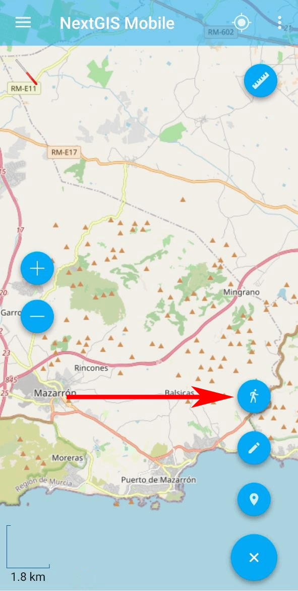

   Selecting feature creation by walking

In the dialog that opens, select the desired vector layer.

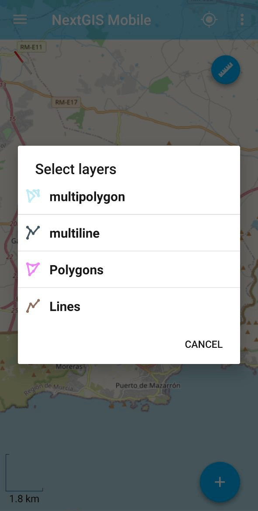
   
   Selecting layer to add geometry by walking
   
This layer will open in Walking mode, and NextGIS Mobile will start recording new geometry into the vector layer.

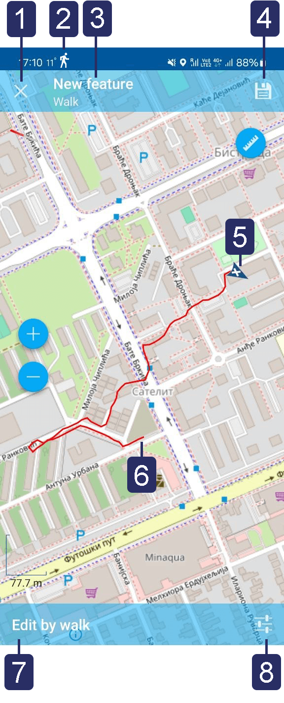

   Adding geometry by walking.
   
   The numbers indicate: 1 - stop recording (without saving); 2 - status icon; 3 - feature ID and layer name; 4 - save feature; 5 - current device location; 6 - starting point; 7 - walking mode indication; 8 - location settings.

.. note:: If you see that the accuracy of the added geometry is insufficient, you can adjust NextGIS Mobile location settings |ic_tune|.

When you've reached the end, tap |ic_save| **Save feature**. 

The attribute input screen opens (see :numref:`ngmobile_input_form_attributes_pic`)
   
Tap |ic_tick| "Apply changes" to finish adding the feature.

   
.. _ngmobile_edit_geometry:

Edit geometry
-------------------

A long press on a feature activates Edit mode. The selected feature changes its color to **blue**, and an editing toolbar appears. Tap the |ic_edit| icon.  After that, the feature changes its color to **red**, a cursor |ic_action_anchor| appears next to it.

.. _ngmobile_edit_point:

Edit point and multipoint
^^^^^^^^^^^^^^^^^^^^^^^^^^^^^^^^^^^

Hold the feature to activate Edit mode (see also `other methods <https://docs.nextgis.com/docs_ngmobile/source/editing.html#ngmobile-switch-to-edit>`_). When editing a **multipoint**, all points belonging to one feature are highlighted. The currently edited point is highlighted in red, and a cursor |ic_action_anchor| is displayed next to it.

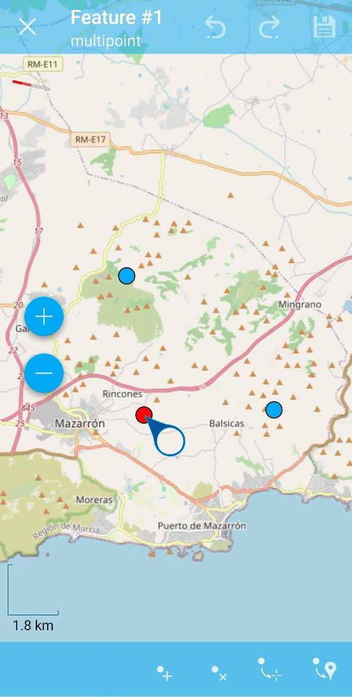

   Multipoint editing

To move the selected point:

* hold the |ic_action_anchor| cursor and drag it to a new location;
* |ic_move_to_center| move the point to the center of the screen; 
* |ic_move_to_loc| move the point to the current device location.

Additional operations are also available for multipoints:

* |ic_add_point| add point to **multipoint** feature; 
* |ic_delete_point| delete selected point from the **multipoint**.

You can cancel editing at any time without saving changes by tapping |ic_cancel|.

To finish editing the geometry and save changes, tap |ic_save|.

.. _ngmobile_edit_line:

Edit line and multiline
^^^^^^^^^^^^^^^^^^^^^^^^^^^^^^^^^^^

A long press on a feature activates the editing panel. Tap the |ic_edit| icon. 

After that, the feature changes its color to **red**, a cursor |ic_action_anchor| appears next to one of the vertices. 

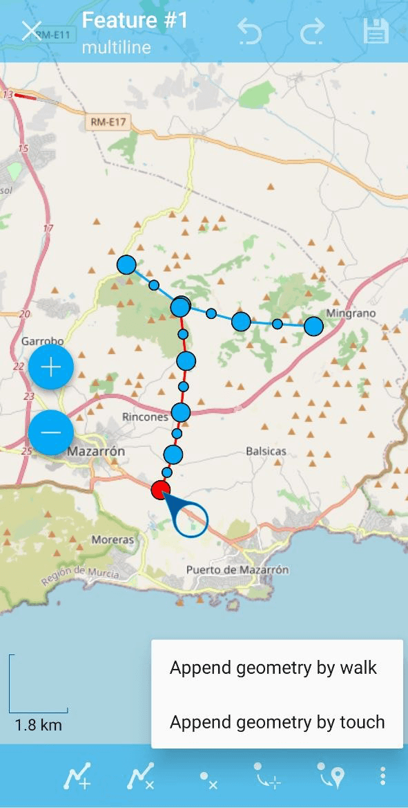

   Multiline editing

When editing a **multiline**, all lines belonging to it are highlighted. The line currently being edited and one of its vertices are highlighted in red, with a cursor |ic_action_anchor| displayed next to the vertex.

To move the selected vertex of the line:

* hold the |ic_action_anchor| cursor and drag it to a new location;
* tap |ic_move_to_center| to move the vertex to the center of the screen; 
* tap |ic_move_to_loc| to move the vertex to your current location.

Also you can:

* add a vertex by selecting the small dot in the middle of the segment and dragging it to the desired location.
* |ic_delete_point| delete selected vertex;
* |ic_add_line| add a new line to the **multiline**;
* |ic_delete_line| delete the selected line from the **multiline**;
* |ic_walk| add vertices by walking;
* |ic_touch| add vertices by touch.

.. note::
   If only one vertex is left, the line is deleted. 

You can cancel editing at any time without saving changes by tapping |ic_cancel|.
   
To finish editing the geometry and save changes, tap |ic_save|.

.. _ngmobile_edit_polygon:

Edit polygon and multipolygon
^^^^^^^^^^^^^^^^^^^^^^^^^^^^^^^^^^^^^^^^^

A long press on a feature activates the editing panel. Tap the |ic_edit| icon. After that, the feature changes its color to **red**, a cursor |ic_action_anchor| appears next to one of the vertices. When editing a **multipolygon**, all its parts are highlighted. The currently edited polygon and one of its vertices are highlighted in **red**, with a cursor displayed next to the selected vertex.

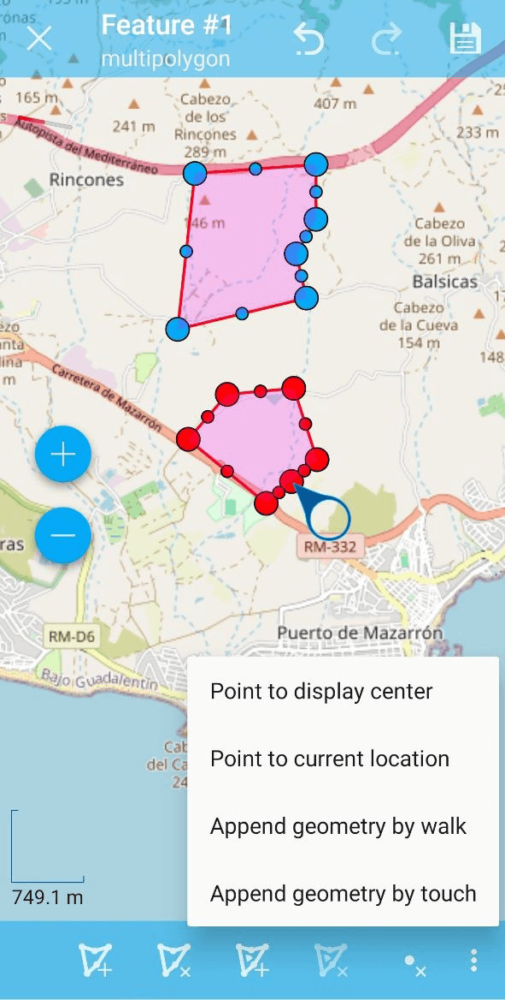

   Editing a multipolygon Options that do not fit in the bottom panel are available in the menu. Tap the three dots on the right side of the panel to open it.

To move the selected vertex:

* hold the |ic_action_anchor| cursor and drag it to a new location;
* tap |ic_move_to_center| to move the vertex to the center of the screen; 
* tap |ic_move_to_loc| to move the vertex to your current location.

Also you can:

* add a vertex by selecting the small dot in the middle of the segment and dragging it to the desired location;
* |ic_delete_point| delete selected vertex;
* |ic_hole| add inner ring (ring geometry is edited the same way as polygon geometry);
* |ic_add_polygon| add a new polygon to the **multipolygon**, 
* |ic_delete_polygon| delete the selected polygon from the **multipolygon**;
* |ic_walk| add vertices by walking;
* |ic_touch| add vertices by touch.

.. note::

  * The ring geometry must be located INSIDE the polygon geometry, otherwise the changes will not be saved!
  * If only two vertices remain, the polygon is deleted. 

You can cancel editing at any time without saving changes by tapping |ic_cancel|.
   
To finish editing the geometry and save changes, tap |ic_save|.

.. _ngmobile_edit_attributes:

Edit attributes
------------------------

Activate Edit mode for the layer. For example, a long press on a feature will open the editing panel. 

After the editing panel opens, select the feature (if it is not already selected) and tap |ic_info| "View feature Attributes" . To proceed to editing, tap |ic_attributes|.

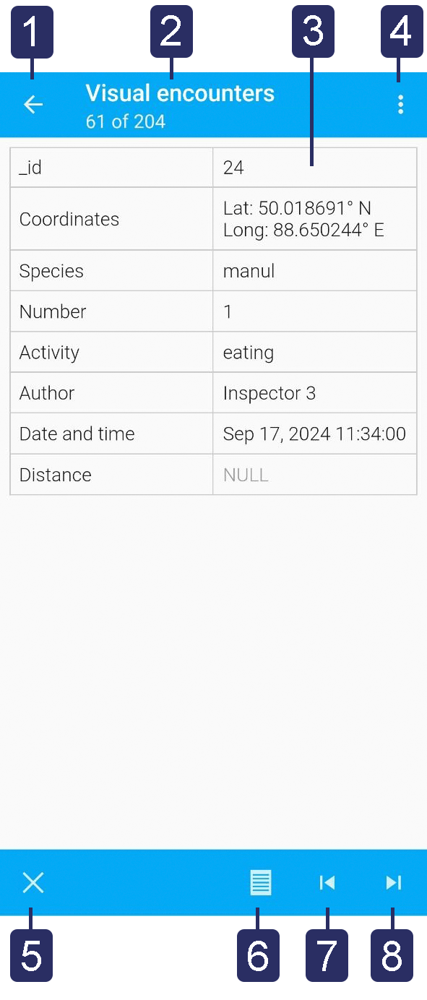

   Viewing attributes.
   
   The numbers indicate: 1 - return to the previous screen; 2 - layer name and feature ID; 3 - attribute fields; 4 - settings; 5 - close attributes viewer; 6 - set attributes; 7 - go to the previous feature in the layer; 8 - go to the next feature in the layer.

NextGIS Mobile displays the following default attribute fields (see :numref:`ngmobile_editing_attributes_pic`, item 4):
   
* For layers with point/multipoint geometry: the location of each point (latitude/longitude).
* For layers with linear/multilinear geometry: the length of each line (in meters).
* For layers with polygonal/multipolygonal geometry: perimeter length (in meters) and area of each polygon (in square meters).

There are two forms for editing attributes:

* `standard form <https://docs.nextgis.com/docs_ngmobile/source/editing.html#ngmobile-edit-attributes-standart>`_ available by default;
* `custom form <https://docs.nextgis.com/docs_ngmobile/source/editing.html#ngmobile-edit-attributes-ngfp>`_ can be added in NextGIS Web.

.. _ngmobile_edit_attributes_standart:

Standard attribute editing form
^^^^^^^^^^^^^^^^^^^^^^^^^^^^^^^^^^^^^^^^^^

On the attribute view screen, tap|ic_attributes| to edit the values.

If a custom form has not been added to the layer, the standard attribute input form opens. It contains all the layer fields, with their names indicated above.

    
   Standard attribute editing form
   
   The numbers indicate: 1 - Back, 2 - Apply changes, 3 - Settings, 4 - Add photo

After all attributes are set, tap |ic_tick| to save the changes. 

The |ic_photo| button allows you to add graphic files (e.g., photos) from local storage to each feature or take new photos and add them.

.. _ngmobile_edit_attributes_ngfp:

Custom form for attribute editing
^^^^^^^^^^^^^^^^^^^^^^^^^^^^^^^^^^^^^^^^^^^^^^^^
   
If a `custom form <https://docs.nextgis.com/docs_ngweb/source/collector.html#collector-create-form>`_ is added to the layer, it will be used for editing attributes. An example of a custom form: 

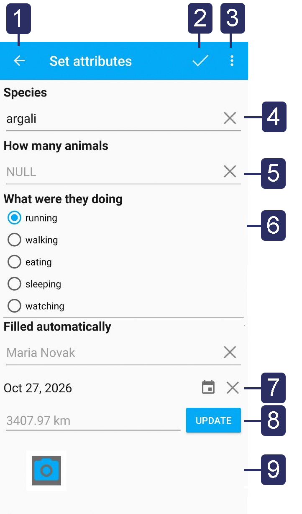
 
   Custom form for editing attributes.
   
   The numbers indicate: 1 - return to the previous screen; 2 - apply changes; 3 - settings; 4 - dropdown list; 5 - field for entering numbers and free text; 6 - radio buttons; 7 - date and time selection; 8 - distance from current location; 9 - add photo.

The attribute editing form can contain the following input fields:

* Text field - for entering text or numbers, depending on the type of the field itself;
* Dropdown, double dropdown, dependent dropdowns - allows selection from a predetermined list. A dependent dropdown allows you to select a broad category first and then a specific item within it, for example, city + city district.
* Checkbox - tick or untick;
* Radio button - selection of one of the possible options;
* Date - select a date from the calendar;
* Photo - create a new photo or upload an image from your device.

.. seealso:: 

   `How to create a custom form <https://docs.nextgis.com/docs_ngweb/source/form_elements.html>`_
   More details on `form elements <https://docs.nextgis.com/docs_ngweb/source/form_elements.html#form-elements>`_

After filling in all the required attributes, tap |ic_tick| "Apply Changes" to save the edits. 

